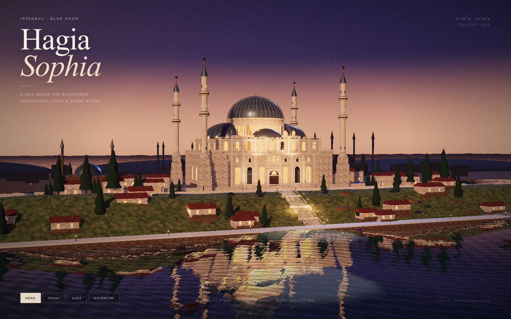

# Hagia Sophia — A Hill Above the Bosphorus

An interactive **Three.js** study of Hagia Sophia on a hill above the sea at twilight: a procedural Blender model, exported to glTF, with a custom procedural ocean shader, real-time water reflections, bloom, soft shadows and four cinematic camera presets.

**[Live demo → fangde.github.io/hagia-sophia](https://fangde.github.io/hagia-sophia/)**



## Controls

- Drag to orbit · scroll / pinch to zoom · right-drag to pan
- **Hero / Front / East / Waterline** buttons fly the camera to four compositions
- Responsive layout for desktop and phones

## What is inside

- **1,213 mesh nodes** exported from Blender 5.2, merged at runtime by material into **22 draw calls**.
- **Custom procedural ocean shader**: four large vertex swells, four analytic fine-ripple bands, a real planar reflection pass, Fresnel mix, animated sun glitter, crest foam and distance fog.
- Custom **sky shader** (deep blue zenith → mauve → peach horizon), faint stars and a PMREM environment map for the lead dome, gold finials, marble and water.
- Runtime procedural canvas textures: **ashlar limestone**, hillside grass/earth, terracotta roof tiles and water normals.
- Warm façade/dome spotlights, low key light with soft shadows, cool rim light, hillside practicals, emissive windows and lamps, and **UnrealBloom** halation.
- Static build, no CDN or external assets.

## Repository layout

```text
index.html               Vite entry
src/main.js              Three.js scene, materials, water, lights, cameras, UI
src/style.css            HUD, loader, responsive layout
public/assets/           GLB used by the dev server
docs/                    GitHub Pages build (committed)
source/                  Blender .blend + procedural generation script
tools/export_glb.py      Blender → GLB export
preview.png              desktop preview
preview-mobile.png       mobile preview
```

## Run locally

```bash
pnpm install
pnpm dev
```

Build the GitHub Pages bundle:

```bash
pnpm build     # outputs docs/
```

Then serve `docs/`:

```bash
cd docs
python3 -m http.server 5188 --bind 127.0.0.1
```

Open <http://127.0.0.1:5188/>.

## Rebuild the Blender source

```bash
/Applications/Blender.app/Contents/MacOS/Blender -b --factory-startup \
  --python source/build_scene_hill_v2.py
```

Re-export the GLB:

```bash
/Applications/Blender.app/Contents/MacOS/Blender -b --factory-startup \
  --python tools/export_glb.py
```

## Notes

- Stylized reconstruction, not a photogrammetric survey. Geometry and lighting are procedural; the runtime stone/grass/tile textures are generated in the browser because glTF cannot carry Blender's procedural node trees.
- The model is a reduced, flat-PBR export of the Blender scene; the `.blend` in `source/` is the authoring file.

## Credits

- Scene, model and code: **fangde** (2026).
- Reference photograph for composition: Radosław Botev, *Hagia Sophia and Sultan Ahmed I Mosque from the Bosphorus*, CC BY 3.0 pl, via Wikimedia Commons.
- Built with [Three.js](https://threejs.org/) (MIT) and Blender.

## License

MIT — see [LICENSE](LICENSE).
